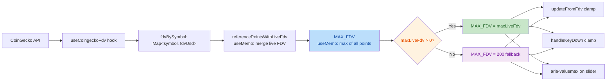

# Rate Calculation Reference

Frontend rate simulation documentation — consolidated from the former multi-file module docs.

> **Incentive sources: `protocol`, `merkl`, `brevis`.** Merit was retired in AAV-1303 and its subsystem deleted; this reference describes the live three-source model only.

## Module Map

| Module | Section |
|---|---|
| Native Aave rate math | [Part 1: Native Rate Simulation](#part-1-native-rate-simulation) |
| Merkl incentive forecast | [Part 2: Merkl Incentive Forecast](#part-2-merkl-incentive-forecast) |
| APR/APY display, USD/day, net eligibility | [Part 3: APR / APY Display Semantics](#part-3-apr--apy-display-semantics) |
| Incentive cap / ceiling reference | [Part 4: Incentive Reward Cap Reference](#part-4-incentive-reward-cap-reference) |
| Simulation null semantics & totalSupplyUsd | [Part 7: Simulation Null Semantics](#part-7-simulation-null-semantics) |
| Calculator invariants (Golden Rules) | [Part 8: Golden Rules](#part-8-golden-rules--rate-simulation-calculator-invariants) |

---

## Part 1: Native Rate Simulation

Source: `src/lib/interestRateCalculator.ts`.

This section covers the native Aave interest-rate math used for supply / borrow simulation.

### Terminology Mapping

| Term / Variable | Alias | Context | Description |
|-----------------|-------|---------|-------------|
| `borrowUsageRatePct` | Utilization | Calculation | `newBorrowed / (liquidity + borrowed + addedLiquidity) × 100`; drives the borrow curve and the displayed utilization |
| `supplyUsageRatePct` | — | Calculation | same numerator; the denominator also adds `deficit` |
| `borrowRatePct` | Borrow rate | Calculation | variable borrow APR, percent |
| `supplyAprPercent` | `liquidityRate` (protocol term) | Output | `borrowRatePct × supplyUsageRatePct / 100 × (1 − protocolFee / 100)` |
| `protocolFee` | `reserveFactor` (V3) / `liquidityFee` (V4) | Input, optional | Fee deducted from interest, percent 0–100; **absent = 0** (AAV-1350) |
| `supplyApyPercent` | — | Output | `supplyAprPercent` with per-second compounding |

The calculator works in **percent floats**. Variable names carry the on-chain vocabulary (`liquidityRate`, RAY-era names) but no RAY value is ever constructed, so the on-chain `rayMul` / `percentMul` sequence does not appear here.

### Constants

| Name | Value | Usage |
|------|-------|-------|
| SECONDS_PER_YEAR | 31536000 | 365 × 24 × 60 × 60, APR → APY conversion |

The on-chain constants (`RAY`, `PERCENTAGE_FACTOR`) belong to Part 1's source protocol math, not to this calculator; see `aaveapy-doc/aave-supply-borrow-rate-formula.md` for the contract-level formulas.

### Input Fields (from `/markets` reserves — `ReserveWithSpread` rate calc fields)

| Field | Type | Unit | Description |
|-------|------|------|-------------|
| `liquidity` | string (raw bigint) | token base units | Available liquidity for borrowing |
| `borrowed` | string (raw bigint) | token base units | Total variable debt |
| `deficit` | string (raw bigint) | token base units | Bad debt; inflates the supply denominator only |
| `protocolFee` | number, optional | percent (0–100) | Clamped to 0–100; absent reads as 0 |
| `optimalUtilization` | number | percent | Target utilization (kink) |
| `baseBorrowRate` | number | percent | Minimum borrow rate |
| `slopeBelowOptimal` | number | percent | Slope below the kink |
| `slopeAboveOptimal` | number | percent | Slope above the kink |
| `decimals` | number, optional | — | Token decimals; defaults to 18 |

### Calculation Steps

#### 1. Parse the user action

```text
addedLiquidity = parseUnits(supplyAmount, decimals)
addedBorrow    = parseUnits(borrowAmount, decimals)
newBorrowed    = borrowed + addedBorrow
```

#### 2. Compute utilization as percent

```text
borrowUsageRatePct = newBorrowed / (liquidity + borrowed + addedLiquidity) × 100
supplyUsageRatePct = newBorrowed / (liquidity + borrowed + deficit + addedLiquidity) × 100
```

The borrow denominator leaves `deficit` out; the supply denominator includes it, which is why the two utilization numbers differ.

#### 3. Compute the variable borrow rate

```text
optimal = max(optimalUtilization, 0.0001)

if borrowUsageRatePct > optimal:
  excessRatio     = (borrowUsageRatePct − optimal) / (100 − optimal)
  borrowRatePct   = baseBorrowRate + slopeBelowOptimal + slopeAboveOptimal × max(excessRatio, 0)
else:
  normalizedUsage = max(borrowUsageRatePct, 0) / optimal
  borrowRatePct   = baseBorrowRate + slopeBelowOptimal × normalizedUsage
```

#### 4. Compute the supply rate

```text
protocolFeeFraction = clamp(protocolFee ?? 0, 0, 100) / 100
supplyAprPercent    = borrowRatePct × (supplyUsageRatePct / 100) × (1 − protocolFeeFraction)
```

This is the whole protocol-fee effect in the calculator: the same field the API calls `protocolFee` holds V3's `reserveFactor` and V4's `liquidityFee`, so one formula serves both. A missing field means 0, which is how V4 spokes with no fee configured reach this step with an unmodified rate.

#### 5. Convert APR to APY

```text
ratePerSecond = (aprPercent / 100) / SECONDS_PER_YEAR
apyPercent    = ((1 + ratePerSecond) ^ SECONDS_PER_YEAR − 1) × 100
```

### Output Structure

```typescript
interface NativeRateSimulation {
  utilizationRateRay: string        // name kept for compatibility; holds utilization as a percent string
  utilizationRatePercent: number
  optimalUtilizationPercent: number
  supplyAprPercent: number
  borrowAprPercent: number
  supplyApyPercent: number
  borrowApyPercent: number
  addedLiquidityRaw: string
  addedBorrowRaw: string
}
```

### Visual Model

```text
Borrow Rate
    │
    │                      ╱ slope2
    │                     ╱
    │                    ╱
    │           ╱───────•  kink at optimalUsageRate
    │          ╱ slope1
    │         ╱
    ├────────•  baseVariableBorrowRate
    │
    └──────────────────────────────► Utilization
```

### Debugging Checklist

| Check | How |
|-------|-----|
| Utilization mismatch | Compare `utilizationRatePercent` vs market `utilizationPct` |
| Rate mismatch | Verify the slope params and `protocolFee`; a missing `protocolFee` means 0%, not "no rate model" |
| Precision | Inputs are raw base-unit strings; the calculator scales to token counts before the percent math |

### Borrow Availability Constraint

```text
Available to Borrow = min(Available Liquidity + Supply Input, Borrow Cap Remaining)
```

Where:

- Available Liquidity = `getReserveAvailableLiquidityUsd(reserve)` (`src/lib/scenarioSize.ts`), derived from the reserve's raw `liquidity`
- Supply Input = user supply input
- Borrow Cap Remaining = `borrowCapUsd − getReserveTotalBorrowedUsd(reserve)`

| Constraint | When Active | UI Message |
|------------|-------------|------------|
| Borrow Cap | `borrowCapRemaining < availableLiquidity` | `limited by borrow cap` |
| Available Liquidity | `availableLiquidity < borrowCapRemaining` | `limited by available liquidity` |

The simulation hook caps borrow input to the effective limit and surfaces which constraint binds.

### Reserve Size, Liquidity, Borrowed (V3 + V4)

`/markets` ships raw amounts only (`supplied`, `liquidity`, `borrowed`, `supplyCap`, `borrowCap`, `deficit`, `decimals`, `tokenPrice`). No `*Usd` value is transported: `BannedReserveUsdFields` (`src/types/aave.ts`) types every one of them as `never`, so a reintroduced read fails the build.

USD conversion lives in `src/lib/scenarioSize.ts`:

| Helper | Input | Result |
|--------|-------|--------|
| `nativeToUsd(raw, decimals, tokenPrice)` | raw base units | USD or `null` |
| `getReserveTotalBorrowedUsd({ borrowed, decimals, tokenPrice })` | reserve | USD or `null` |
| `getReserveAvailableLiquidityUsd({ liquidity, decimals, tokenPrice })` | reserve | USD or `null` |
| `getScenarioSupplySizeUsd({ reserveSizeUsd, supplyCapUsd, rawSupplyInput })` | base USD + scenario input | size after the input, capped |
| `getSuppliableUsd` / `getBorrowableUsd` / `getAvailableToBorrowUsd` | caps + current values | remaining room |

Reserve size for display comes from `supplied` (`ReservesTable.getDisplayReserveSizeUsd` → `nativeToUsd` → `getScenarioSupplySizeUsd`).

**Hub aggregation.** For V4, `liquidity` is free Hub liquidity shared across Spokes while `supplied` is the per-Spoke slice. Deriving one from the other breaks: `supplied − borrowed` yields a per-Spoke remainder, not Hub liquidity, and can go negative. Simulation metrics carry the Hub-aggregated values as `marketMetrics.totalBorrowedUsd` / `marketMetrics.availableLiquidityUsd`.

---

## Part 2: Merkl Incentive Forecast

Source: `src/lib/merklForecast.ts`.

This section covers `forecastWithTVL` and how Merkl forecast data plugs into simulation.

### How simulation connects

- User input is converted to USD for incentives (`supplyInputUsd` / `borrowInputUsd`).
- For a forecast row with a matching `campaignId`:

```text
hypotheticalTvl = max(0, latestTvl + inputUsd)
```

- If `inputUsd ≤ 0` or no forecast row exists, the UI keeps the current reserve Merkl APR.

`getMerklBreakdownApr` precedence:

1. `campaignApr > 0` → use directly
2. `pointsPerThousandUsd` present and positive → Tydro points formula (`points × pointToUsdRate × 36.5`)

`safePointToUsdRate` guard: `pointToUsdRate = 0` is **passed through** (user explicitly set $0/INK to zero out rewards); only NaN, Infinity, or negative values fall back to the default rate (1).
3. `DUTCH_AUCTION` → implied APR from `plannedDaily / latestTvl × 365 × 100`
   (points-to-USD conversion applied only when `pointsPerThousandUsd` field is present;
   non-points campaigns use neutral rate 1)
4. Return `0` (MAX/FIX capped fallbacks are handled by `forecastWithTVL`, not here)

### Dutch auction fallback rule

`DUTCH_AUCTION` uses a fallback APR from `plannedDaily / latestTvl` when `campaignApr` and Tydro points are both unusable.

- Scope: `campaignType === 'DUTCH_AUCTION'` only
- Inputs: `plannedDaily`, `latestTvl`
- Applies regardless of whether `pointsPerThousandUsd` field is present
- When the points field is present, `plannedDaily` is treated as points and converted to USD via `pointToUsdRate`
- When the points field is absent, `plannedDaily` is already in USD (neutral rate 1)
- Non-DUTCH campaign types do **not** use this fallback path; MAX/FIX rely on `forecastWithTVL`

### Symbols

| Symbol / field | Meaning |
|----------------|---------|
| `tvl` | USD eligible TVL passed into `forecastWithTVL` |
| `aprCap` | Annual APR as decimal fraction |
| `plannedDaily` / `requiredDaily` | Backend daily emission targets |
| `remainingBudget` | `max(0, totalBudget - distributedSoFar)` |

### Campaign type matrix

| `campaignType` | Forecast path | Uses `requiredDaily` from side-data? | Fallback when missing | Returned fields |
|----------------|---------------|--------------------------------------|-----------------------|-----------------|
| `DUTCH_AUCTION` | Planned-only | No | `plannedDaily` | `dailyRewards`, `apr`, `regime` |
| `MAX_REWARD_VALUE_PER_LIQUIDITY_VALUE` | Capped by APR, then catch-up via required daily emission | Yes | `plannedDaily` | `dailyRewards`, `apr`, `regime` |
| `FIX_REWARD_VALUE_PER_LIQUIDITY_VALUE` | Fixed APR budget path | No | N/A | `dailyRewards`, `apr`, `regime`, `fixRewardableDays`, `fixRewardableUntilTs` |

### FIX Mode Variables by Distribution Variant

FIX 模式的完整变量链，按 `distributionType` 区分单位。

#### 变量来源表

| 变量 | 来源 | VALUE (USD) | AMOUNT_PER_VALUE | AMOUNT_PER_AMOUNT |
|---|---|---|---|---|
| `campaign.amount` | Merkl API | raw tokens (有 price) | raw tokens (无 price) | raw tokens (无 price) |
| `totalBudget` | Backend | USD (amount × price) | reward tokens | reward tokens |
| `distributedSoFar` | Backend (metrics 累加) | USD | reward tokens (`totalInToken`) | reward tokens (`totalInToken`) |
| `aprCap` | Backend (`distributionSettings.apr`) | decimal (USD/USD/yr) | tokens/USD/yr | tokens/token/yr |
| `latestTvl` | Backend (metrics) | USD | USD | **无** (API 返回 0) |
| `plannedDaily` | Backend = `totalBudget / totalDays` | USD/day | tokens/day | tokens/day |
| `requiredDaily` | Backend = `remainingBudget / remainingDays` | USD/day | tokens/day | tokens/day |
| `remainingBudget` | Frontend = `totalBudget - distributedSoFar` | USD | tokens | tokens |
| `aprBasedDaily` | Frontend = `tvl × aprCap / 365` | USD/day | tokens/day ✅ | **无法计算** (tvl=0) |
| `dailyRewards` | Frontend = `min(aprBasedDaily, remainingBudget)` | USD/day | tokens/day | **0** |
| `apr` | Frontend = `dailyRewards × 365 / tvl` | 百分比 | tokens/USD/yr | **0** |
| `fixRewardableDays` | Frontend = `remainingBudget / aprBasedDaily` | days | days | **∞** (aprBasedDaily=0) |

#### 单位一致性验证

**AMOUNT_PER_VALUE**:
- `aprCap = 18.25 tokens/USD/yr`
- `tvl = USD`
- `aprBasedDaily = tvl(USD) × 18.25 / 365 = tokens/day` ✓
- `dailyRewards = min(tokens/day, tokens) = tokens/day` ✓
- `apr = tokens/day × 365 / tvl(USD) = tokens/USD/yr` ✓
- **结论**：单位链自洽，但 `apr` 不是百分比 USD APR

**AMOUNT_PER_AMOUNT**:
- `aprCap = 3650 tokens/token/yr`
- `tvl = 0` (API 无数据)
- `aprBasedDaily = 0 × 3650 / 365 = 0`
- `dailyRewards = 0`
- `apr = 0`
- **结论**：forecast 完全不可用

#### API vs Frontend 计算

| 变量 | 谁计算 | 公式 |
|---|---|---|
| `totalBudget` | Backend | `campaign.amount / 10^decimals × (price ?? 1)` |
| `distributedSoFar` | Backend | `sum(metrics.dailyRewardsRecords[].totalInToken)` for AMOUNT |
| `aprCap` | Backend | `distributionSettings.apr` (decimal) |
| `latestTvl` | Backend | `metrics.tvlRecords[].total` (VALUE) / `.totalInToken` (AMOUNT) |
| `plannedDaily` | Backend | `totalBudget / ((endTs - startTs) / 86400)` |
| `requiredDaily` | Backend | `(totalBudget - distributedSoFar) / remainingDays` |
| `remainingBudget` | Frontend | `totalBudget - distributedSoFar` |
| `aprBasedDaily` | Frontend | `tvl × aprCap / 365` |
| `dailyRewards` | Frontend | `min(aprBasedDaily, remainingBudget)` |
| `apr` | Frontend | `dailyRewards × 365 / tvl` |
| `fixRewardableDays` | Frontend | `remainingBudget / aprBasedDaily` |
| `fixRewardableUntilTs` | Frontend | `min(endTs, nowTs + fixRewardableDays × 86400)` |

#### AMOUNT 变体的 USD APR 问题

**AMOUNT 变体没有 USD APR 概念**（`rewardToken.price = null`）。当前代码路径：
1. Backend `campaignApr = distributionSettings.apr`（token 利率）
2. Frontend 显示为"百分比 APR"（错误）

**正确处理**：
1. Backend 尝试获取 `rewardToken.price`（已有 → 用；无 → CoinGecko）
2. 若无 price → `campaignApr = 0` + `campaignAprUnavailable = true`
3. 若有 price：
   - AMOUNT_PER_VALUE: `usdApr = tokenApr × price`
   - AMOUNT_PER_AMOUNT: `usdApr = tokenApr × rewardPrice / targetPrice`（需两个价格）
4. Frontend 检查 `campaignAprUnavailable` → em dash + tooltip

Current source wiring:

- `src/hooks/useRateSimulation.ts` and `src/components/dashboard/MerklForecastPanel.tsx` both merge `requiredDaily` from `/meta/side-data` into the forecast state.
- `src/lib/merklForecast.ts` still resolves `requiredDaily ?? plannedDaily` on the MAX path only.
- If `requiredDaily` is absent, the fallback is `plannedDaily`; if that is also missing, the safe value becomes `0`.
- `/markets` does **not** return `requiredDaily` for `DUTCH_AUCTION`; that campaign type uses the Dutch-auction fallback path only and does not depend on side-data.

### `campaignApr` 与 `plannedDaily + TVL` 的一致性核对

当你需要验证接口返回的 `campaignApr` 是否等于反推值时，请按**百分比点位**统一口径：

```text
impliedAprPercent = plannedDaily * 365 / tvl * 100
```

`campaignApr` 与 `impliedAprPercent` 的关系是**按 campaignType 分支**判断：

- `DUTCH_AUCTION`：
  - 理想情况 `campaignApr` 会等于 `impliedAprPercent`（或与它只差浮点噪声）。
  - 若 `campaignApr == 0` 且 `pointsPerThousandUsd` 字段存在（包括值为 `0`、无效值），则 points 语义仍保留，但 fallback 只在 Dutch auction 上启用。

- `MAX_REWARD_VALUE_PER_LIQUIDITY_VALUE`：
   - 不能直接用 `plannedDaily` 做反推。
   - 需要先按分支计算：
   ```text
   aprBasedDaily = (tvl * aprCap) / 365
   dailyRewards = min(requiredDaily, aprBasedDaily)
   campaignAprEff = (dailyRewards * 365) / tvl
   ```
   其中 `requiredDaily` 来自 side-data forecast state，缺失时回退为 `plannedDaily`。

- `FIX_REWARD_VALUE_PER_LIQUIDITY_VALUE`：
  - 不能直接用 `plannedDaily` 做反推。
  - 需先按分支计算：
  ```text
  aprBasedDaily = (tvl * aprCap) / 365
  dailyRewards = min(aprBasedDaily, remainingBudget)
  campaignAprEff = (dailyRewards * 365) / tvl
  ```

一个经验可复现结果（按当前快照）是：非零 `campaignApr` 中，主要偏差都发生在 MAX/FIX 分支；points 模式常见 `campaignApr=0`、`pointsPerThousandUsd>0` 且 `impliedAprPercent` 为正值，不应判定为异常。

### 结论速记（通用）

- `DUTCH_AUCTION` 可以用 `plannedDaily + latestTvl` 做 Dutch-auction fallback 对账。
- `MAX_REWARD_VALUE_PER_LIQUIDITY_VALUE` / `FIX_REWARD_VALUE_PER_LIQUIDITY_VALUE` 不能只用 `plannedDaily` 反推；必须走 capped 分支（`requiredDaily`、`aprCap`，以及 FIX 的 `remainingBudget`）。
- `campaignApr == 0` 且 `pointsPerThousandUsd` 字段存在时视为 points 模式；若字段值为 `0` / 无效，只有 `DUTCH_AUCTION` 继续走该 fallback。

### Session Notes (campaignApr reconciliation)

- 本次修复把 `pointsPerThousandUsd` 的"字段存在性"纳入分支判断，避免 `0` / 无效值被当成非 points 处理。
- `DUTCH_AUCTION` 的 fallback 只在 points 字段存在但值不可用时启用。
- 已新增真实 fixture 的回归测试，确保 Dutch-auction fallback 不会被其它 campaignType 复用。

### 对账输出建议（`campaignApr` vs `planned+TVL`）

建议把每条活动按以下三类输出，便于判断是否异常：

- `plain-match`
  - `campaignType` 为 `DUTCH_AUCTION`
  - 且 `|impliedAprPercent - campaignApr| <= tolerance`
  - 或者 `campaignApr == 0` + `pointsPerThousandUsd > 0` 且 `campaignApr` 被规则定义为 points 模式

- `capped-required`
  - `campaignType` 为 `MAX_REWARD_VALUE_PER_LIQUIDITY_VALUE` 或 `FIX_REWARD_VALUE_PER_LIQUIDITY_VALUE`
  - 需要用 `requiredDaily`/`aprCap`/`remainingBudget` 重建 `campaignAprEff`
  - 与 `campaignAprEff` 比较

- `needs-data-check`
  - 缺失关键字段：`latestTvl`、`requiredDaily`、`aprCap`、`totalBudget/distributedSoFar`
  - 或者 `tvl <= 0`

简化脚本输出样例：

```text
campaignId=... chain=... token=... side=... type=... category=plain-match | tol=0.0001
  campaignApr=1.05% | implied=1.0500% | diff=+0.0000pp

campaignId=... type=MAX_REWARD_VALUE_PER_LIQUIDITY_VALUE category=capped-required
  campaignApr=1.75% | projectedApr=1.78% | diff=+0.03pp | requiredDaily=... | aprCap=...

campaignId=... category=needs-data-check
  miss=latestTvl=0 or requiredDaily missing
```

用于你这次结论时：先看 `category`，再看 `type`。

### FIX branch

```text
aprBasedDaily  = (tvl × aprCap) / 365
dailyRewards   = aprBasedDaily
apr            = aprCap
```

APR 始终等于 `aprCap`，不会因 TVL 增大或预算不足而降低。预算能支撑多久由 `fixRewardableDays` 和 `fixRewardableUntilTs` 告知用户（UI 显示 `~Nd earn`，小于 1 天时用两位小数如 `~0.09d earn`）。

**FIX APR 不会稀释的依据**（Merkl 官方文档 `docs.merkl.xyz/merkl-mechanisms/distributions`）：
> Fixed Reward Rate — Campaign may finish earlier: Campaigns end when funds are depleted or when the scheduled duration expires. If a campaign runs out of funds before its end date, rewards are split proportionally (like a variable reward rate campaign) in the final run, then the campaign closes.

最后一轮按比例分配（proportional split）在数学上等价于"完整 APR 应用不足一天的有效时长"：每人的实际收益 = `aprCap × (fixRewardableDays / 365)`。因此 `fixRewardableDays` 精确表达了 Merkl 的行为——APR 不变，只是有效时长缩短。

### MAX / capped APR branch

```text
aprBasedDaily = (tvl × aprCap) / 365
dailyRewards   = min(requiredDaily, aprBasedDaily)
apr            = (dailyRewards × 365) / tvl
```

- `APR_CAPPED` means the cap binds.
- `CATCHING_UP` means required daily emission is above planned daily by tolerance.
- This branch does not multiply by `remainingBudget`.

### DUTCH_AUCTION

```text
dailyRewards = plannedDaily
apr = (dailyRewards × 365) / tvl
```

`DUTCH_AUCTION` does not use `requiredDaily` or APR-cap catch-up logic.

### Other non-FIX/MAX types

The current code does not apply a separate forecast branch to additional campaign types. They flow through the same MAX-style fallback path unless new handling is added.

### Edge case

If `tvl ≤ 0`, both `dailyRewards` and `apr` are `0`.

### Model APR to UI percentage

```text
forecastAprPercent = forecast.apr × 100 × multiplier
```

`multiplier` is `1` unless Tydro points are involved.

### Session Notes (Merkl forecast)

- Points campaigns now use field presence, not just `> 0`, to decide whether to enter points-aware handling.
- For real points fixtures, implied APR and traditional points APR should match after `plannedDaily -> USD` conversion.
- `latestTvl` stays in USD in the implied APR fallback; only `plannedDaily` is converted from points to USD.
- `src/lib/tydro.test.ts` includes a regression test that asserts the real fixture stays aligned across both formulas.

---

## Part 3: APR / APY Display Semantics

This section covers display-time behavior, cashflow semantics, and net-position eligibility.

### Native vs incentive rates

- Native Aave rates stay in APY in the UI.
- Incentive / forecast-derived rates follow the global APR/APY toggle.

### Incentive APR → APY conversion

```text
aprDecimal = aprPercent / 100
apyPercent = ((1 + aprDecimal / 12) ^ 12 - 1) × 100
```

Applied consistently to Merkl, Brevis, protocol incentive rows, and incentive totals.

### Total rate composition

- Supply total = `nativeSupplyApy + incentiveDisplayValue`
- Borrow total = `nativeBorrowApy - incentiveDisplayValue`

The toggle changes incentive contribution only, not the native base rate.

### Scenario USD/day (`scenarioUsdAccrual`)

Source: `src/hooks/useRateSimulation.ts` (`buildSupplyUsdAccrualSide`, `buildBorrowUsdAccrualSide`).

Each scenario side computes a daily USD cashflow from the **after-simulation** rates.

#### Supply side

```text
nativeUsdPerDay    = principalUsd × ((1 + nativeApyDecimal)^(1/365) − 1)    // Aave per-second APY → daily
incentiveUsdPerDay = principalUsd × incentiveAprPercent / 100 / 365          // APR-linear
totalUsdPerDay     = nativeUsdPerDay + incentiveUsdPerDay
```

Where `nativeApyDecimal` comes from `nativeAprPercentToApyPercent` (Aave per-second compounding: `(1 + apr / SECONDS_PER_YEAR)^SECONDS_PER_YEAR − 1`).

#### Borrow side

```text
nativeUsdPerDay    = −principalUsd × ((1 + nativeApyDecimal)^(1/365) − 1)   // negative (interest paid)
incentiveUsdPerDay =  principalUsd × incentiveAprPercent / 100 / 365          // positive (rebate)
totalUsdPerDay     = nativeUsdPerDay + incentiveUsdPerDay
```

#### Net USD/day

```text
netUsdPerDay = supplyTotalUsdPerDay + borrowTotalUsdPerDay
```

Supply is positive earnings; borrow native is negative cost; borrow incentive is positive rebate. `netUsdPerDay` is the combined daily cashflow for the position.

#### Type structure

```typescript
interface ScenarioUsdAccrualSide {
  nativeUsdPerDay: number | null;      // supply: positive; borrow: negative
  incentiveUsdPerDay: number | null;   // supply: positive; borrow: positive (rebate)
  totalUsdPerDay: number | null;       // native + incentive for this side
}

interface ScenarioUsdAccrual {
  supply: ScenarioUsdAccrualSide | null;
  borrow: ScenarioUsdAccrualSide | null;
  netUsdPerDay: number | null;         // supply total + borrow total
}
```

Present when at least one side has scenario principal; `null` otherwise.

#### Key invariant

Toggling APR/APY display mode must **not** change `scenarioUsdAccrual` outputs. Native daily USD uses Aave per-second compounding; incentive daily USD uses APR-linear dailyization. Both are independent of the display toggle.

#### UI consumption

| Component | File | Usage |
|-----------|------|-------|
| `SimulationSubRow` | `src/components/dashboard/SimulationSubRow.tsx` | Displays `netUsdPerDay` alongside per-side native/incentive breakdown |

### Net Position Eligibility (Scenario Simulation)

Each Merkl opportunity declares its own eligibility rule; Brevis and protocol incentives have none.

| Eligibility mode | Used by | Formula |
|------------------|---------|---------|
| Net | Merkl `netPositionConstraint` | `max(source − Σ offset, 0)` per side |
| Paired | Merkl `crossAssetPairing` | `min(source, paired × discountFactor)` |
| Gross | Merkl without a constraint, Brevis, protocol rows | `supply` / `borrow` |

```text
eligibilityRatio = netInputUsd / grossInputUsd
effectiveAPR = poolForecastAPR × eligibilityRatio
```

Single-input scenarios keep `eligibilityRatio = 1`.

When `eligibilityRatio < 1`, rows show a net eligibility hint via `capNote`.

---

## Part 4: Incentive Cap Reference

Three cap mechanisms are live: Merkl pool budget, Merkl APR cap, and the per-user position cap shared by Merkl and Brevis. Protocol rows are flat APRs with no cap.

### Naming layers

| Layer | Role | Examples |
|-------|------|----------|
| API | Backend field names stay stable | `positionCapNative`, `positionCapUsd` |
| Domain | Prefer `cap` vocabulary | `positionCapUsd`, `eligibleUsd` |
| UI | Stable row diagnostics | `capNote`, `capWarning` |

### Field mapping

| Source | API fields | Resolution |
|--------|------------|------------|
| Merkl breakdown | `positionCapNative`, `positionCapUsd`, `isCombineCap`, `aprCap` | `resolvePositionCapUsd(positionCapNative, positionCapUsd, tokenPrice, decimals)` — the native amount wins when the reserve price is known |
| Brevis campaign | `positionCapUsd`, `isCombineCap` | used as-is; the fetcher always emits `isCombineCap: true` alongside a cap (`packages/aave-fetcher/src/brevis-api.ts`) |
| Protocol row | `supplyIncentives` / `borrowIncentives` (`number[]`) | none, and neither has an API producer — the `protocol` lane evaluates to 0 on every live reserve (AAV-1350 deprecation in `src/types/aave.ts`) |
| Simulation UI | same diagnostics | `capNote`, `capWarning` |

A cap whose USD value cannot be resolved is left unapplied rather than estimated.

### Unified simulation `capNote` strings

Source: `src/lib/incentiveCaps.ts` (`capEffectToNote`).

| `type` | When shown | Text |
|--------|------------|------|
| `position_cap` | A per-user cap applies | `Incentive limited to first $X`; appends `· combined supply + borrow` when `isCombineCap`, and `~Nd earn` when the budget horizon resolves |
| `pool_budget` | Merkl FIX / TARGET horizon resolved | `~Nd earn` |
| `apr_cap` | Merkl MAX with low TVL | `APR capped for low TVL` |
| `net_eligible` | An opportunity-declared net constraint dilutes the rate | `$X of $Y net eligible` |

### Cap taxonomy

| Cap type | Scope | Mechanism | Source file |
|----------|-------|-----------|-------------|
| Pool budget | Pool-wide | `fixRewardableDays = remainingBudget / dailyRewards` | `merklForecast.ts` → `buildFixRewardCapEffect` |
| APR cap | Pool-wide | MAX regime caps the APR when TVL is low | `merklForecast.ts` → `buildMaxRewardCapEffect` |
| Position cap | Per-user | `eligibleUsd = min(positionUsd, positionCapUsd)`; effective APR `= nominal × eligibleUsd / positionUsd` | `applyPositionCapToForecastResult` |

Caps apply only where a position is known: the per-campaign rows and `sr.*` lanes of `rateSimulationCalculator.ts`, plus the Merkl aggregate sums in `incentiveAggregation.ts` when they receive `positionUsd`. `headlineIncentive` stays uncapped by design (Golden Rule 4).

### Merkl position cap

- A breakdown may cap the earning position: `eligibleUsd = min(positionUsd, cap)`, and the displayed APR dilutes to `nominal × eligibleUsd / positionUsd`.
- `isCombineCap` shares one cap across the supply and borrow campaigns of the same opportunity.
- The cap arrives as a native token amount, so the USD value needs `tokenPrice` + `decimals`. Every call site passes the reserve's own values, including the Portfolio fallback (AAV-1350): a cap applied without them silently reports the undiluted APR.

### Brevis position cap

- `positionCapUsd` caps the earning position, so `eligibleUsd = min(positionUsd, positionCapUsd)` and the APR dilutes the same way as Merkl's.
- `positionUsd = combinedDepositUsd ?? totalPositionUsd ?? inputUsd`; the combined value requires the same `campaignId` and matching metadata across supply and borrow.
- An open-ended campaign (no `campaignEndedAt`) still counts as active (`allowOpenEnd = true` in `hasActiveBrevisBreakdown`) and keeps its cap; only the `~Nd` horizon note is dropped, because `remainingDays` arrives as `null`.

Brevis exposes no structured cap field. `extractPositionCapFromDescription()` (`packages/aave-fetcher/src/brevis-api.ts`) scrapes the campaign copy out of the Brevis frontend `_app` chunk and parses `/up to ([\d,]+)\s*(USDC|USD)/i`, so the copy is the semantic source and that regex is the contract. Live copy, 2026-11-12:

> Eligible MetaMask Card users … may earn a fixed 2.4% reward APR when lending or borrowing USDC on Aave via Linea. This promotional rate applies to a combined total of up to 5000 USDC in collateral and/or debt per user.

That sentence makes `positionCap` a principal ceiling spread across supply and debt; principal and payout coincide only because the APR is fixed. Two edges follow: a campaign whose copy capped the payout would land in the same field silently (none today — the only observed `type === 3001` family is MetaMask), and a reworded sentence breaks the scrape, since the chunk scan keys off the literal markers `Eligible MetaMask` and `per user.` and a miss only logs a warning. Campaign-level evidence: `docs/api/brevis-supplement.md` §2.5.

### Merkl FIX reward cap

- `fixRewardableDays` and `fixRewardableUntilTs` come from remaining budget divided by daily rewards.
- This is a pool-level cap shared by all users.

### UI surfaces

- `IncentiveTooltip` keeps static context only.
- `SimulationSubRow` uses `capNote` / `capWarning` for per-campaign diagnostics.

---

## Related Files

- `src/lib/interestRateCalculator.ts` – Core native rate calculation functions
- `src/lib/merklForecast.ts` – Merkl + Brevis unified `forecastWithTVL` and progress flags
- `src/lib/incentiveCaps.ts` – Domain-layer cap effects → simulation `capNote` / `capWarning`
- `src/lib/tydro.ts` – Tydro points-to-USD conversion
- `src/hooks/useRateSimulation.ts` – React hook: native simulation + incentive forecast overlay; `buildSupplyUsdAccrualSide` / `buildBorrowUsdAccrualSide` for USD/day
- `src/lib/portfolioSimulator.ts` – Portfolio mode: groups positions by reserve, calls buildRateSimulationResult per group with supply+borrow USD, Hub aggregation, fallback to static APY
- `src/hooks/reserves-table/usePortfolioToggle.ts` – Portfolio toggle handler; optional `simulationContext` param bridges full rate simulation into portfolio mode; fallback uses reserve.supplyApy/borrowApy + sum incentives
- `src/lib/formatters.ts` – Display formatting; `annualPercentToDailyFraction` (APY compound vs APR-linear dailyization)
- `docs/frontend-data-loading-matrix.md` – Data loading architecture
- `docs/design/frontend-interaction-guardrails.md` – Interaction design guardrails

---

## Part 5: Portfolio Mode Rate Simulation

Source: `src/lib/portfolioSimulator.ts`

Portfolio mode (Portfolio toggle) computes per-position APR by reusing the same `buildRateSimulationResult` pipeline as single-reserve simulation, with supply+borrow on the same reserve **grouped** into a single call.

### Grouping

Positions are grouped by `getReserveKey(reserve)` (= `reserveId.trim()`). Same-reserve supply + borrow positions are merged; same side positions have their USD amounts summed.

### Per-group simulation

For each group:

1. **deep-copy**: `reserveRateInput = hasRateCalcFields(reserve) ? { ...reserve } : null`
2. **Hub field resolution** (V4): replace `reserveRateInput.borrowed` with `reserve.hubBorrowed` (the SDK's Hub-level total borrowed) when it exists; `liquidity` already arrives Hub-level, so it needs no rewrite
3. **Call `buildRateSimulationResult`** with `supplyInput = String(supplyUsd)`, `borrowInput = String(borrowUsd)`, `inputMode: 'usd'`, `merklNetPosition` defaults to `true`
4. **Extract per-position rate**: `afterNative ?? currentNative ?? reserve.supplyApy ?? 0` (supply) / analogous for borrow; `afterIncentive ?? currentIncentive ?? 0`. **Note**: `afterNative` is always APY regardless of `isApy` toggle — native rate never switches to APR (per AprApyToggle contract: "Only incentive annual % follows this switch; native stays APY"). Only `afterIncentive` follows the APR/APY toggle.
5. **Build `PortfolioPositionResult`** via `buildPortfolioPositionResult`

### Fallback (simplified calculation)

When `simulationContext` is not provided:

- `nativePercent = reserve.supplyApy / borrowApy` (backend static value)
- `incentivePercent = getCampaignIncentiveValues(reserve, side, tydroPointToUsdRate, { whitelistMerklCampaignIds, forecastStates, positionUsd, tokenPrice: reserve.tokenPrice, decimals: reserve.decimals })` → `.apy` or `.apr` per the toggle — Merkl `breakdowns[].campaignApr` plus Brevis, with the position cap applied. The position, price, and decimals are what let a capped campaign dilute (AAV-1350); dropping them reports the undiluted APR. It never reads the legacy flat `supplyIncentives` / `borrowIncentives` arrays, which have no backend producer.

A reserve that lacks rate-calc fields still goes through the calculator: `hasRateCalcFields` gates the **native rate curve** only. Incentive APR needs no curve, and a missing `protocolFee` means 0, not "no rate model" (AAV-1350).

### `simulationContext` fields

| Field | Source | Role |
|-------|--------|------|
| `isApy` | AprApyToggle | APY compounding vs APR display |
| `whitelistMerklCampaignIds` | scenario strip | Merkl whitelist-only campaign opt-in |
| `tydroPointToUsdRate` | side-data | Tydro points→USD conversion |
| `forecastStates` | side-data | Merkl 10-min metrics for forecast |

### Hub aggregation in Portfolio

V4 needs Hub-level debt inside the calculator: `reserveRateInput.borrowed` is overwritten with `reserve.hubBorrowed`, and `liquidity` is already a Hub-level figure. The overwrite happens once per reserve group, so several positions on the same reserve share it without double-counting.

---

## Part 6: Ink Price Reference (FDV-Based)

Source: `src/components/dashboard/InkAprCalculator.tsx`, `src/hooks/useCoingeckoFdv.ts`.

The Ink APR calculator uses a FDV-based price model: the user estimates INK token FDV in billions USD, and the calculator derives a token price from `FDV / TOTAL_SUPPLY`. A slider with CEX benchmark reference points provides visual context.

### Price Derivation

```text
tokenPrice = (FDV_billions × 10^9) / TOTAL_SUPPLY
```

Where `TOTAL_SUPPLY = 1_000_000_000` (1B INK tokens).

### MAX_FDV: Dynamic from CoinGecko Reference Points

`MAX_FDV` is the slider endpoint and input clamp ceiling. It is derived dynamically from live CoinGecko data, not hardcoded.

**Data Flow:**



**Technical Call Chain:**

```mermaid
sequenceDiagram
    participant Component as InkAprCalculator
    participant Hook as useCoingeckoFdv
    participant Memo1 as referencePointsWithLiveFdv
    participant Memo2 as MAX_FDV useMemo
    Component->>Hook: fdvBySymbol
    Note over Hook: Returns Map&lt;symbol, fdvUsd&gt;
    Hook-->>Memo1: live FDV data
    Memo1->>Memo1: Merge live FDV into REFERENCE_POINTS
    Memo1-->>Memo2: referencePointsWithLiveFdv
    Memo2->>Memo2: Reduce: max of all point fdvs
    alt Has live data
        Memo2-->>Component: MAX_FDV = maxLiveFdv (e.g. 120)
    else No live data
        Memo2-->>Component: MAX_FDV = 200 (fallback)
    end
    Component->>Component: updateFromFdv / handleKeyDown<br/>use Math.min(MAX_FDV, value)
```

### Design Decisions

| Decision | Rationale |
|----------|-----------|
| MAX_FDV = max of all reference point live FDVs | Slider endpoint and input clamp always in sync. No distinction between full/partial availability — as long as at least one live FDV exists, use the max. |
| Fallback = 200 (billions) | When no live CoinGecko data at all. Conservative ceiling above typical CEX FDVs. |
| No input limit when no data | If all reference points return null, the fallback 200 serves as the slider endpoint and input clamp. The slider and input are always unified. |
| `useMemo` dependency on `referencePointsWithLiveFdv` | Automatically recomputes when CoinGecko data updates. Dependency chain: `fdvBySymbol` → `referencePointsWithLiveFdv` → `MAX_FDV`. |

### Reference Points

`REFERENCE_POINTS` is a hardcoded array of CEX benchmark tokens with their FDV values and slider positions:

| Token | Exchange | Hardcoded FDV (B) | Position | Live Source |
|-------|----------|-------------------|----------|-------------|
| GT | Gate | 1.0 | 0 | CoinGecko |
| OKB | OKX | 2.1 | 3 | CoinGecko |
| BGB | Bitget | 4.5 | 8 | CoinGecko |
| MNT | Mantle | 5.0 | 10 | CoinGecko |
| CRO | Crypto.com | 8.5 | 25 | CoinGecko |
| BNB | Binance | 115.8 | 100 | CoinGecko |

Each reference point's `fdv` is replaced by live CoinGecko data when available. The `default` point (fdv=1.0, isDefault=true) is never replaced — it acts as a floor ensuring `maxLiveFdv > 0` always holds.

### CoinGecko Integration

Source: `src/hooks/useCoingeckoFdv.ts`.

- Uses React Query with staleTime and cache persistence.
- Fetches FDV data for a predefined list of token IDs.
- Returns `fdvBySymbol: Map<string, number>` (symbol → fdvUsd).
- `InkAprCalculator` calls `useCoingeckoFdv()` and passes `fdvBySymbol` to `referencePointsWithLiveFdv`.

### Input Behavior

The FDV input uses `useDebouncedInput` (300ms debounce, 2 decimal places). On commit:

```text
clampedFdv = Math.max(MIN_FDV, Math.min(MAX_FDV, parsedFdv))
tokenPrice = (clampedFdv × 1e9) / TOTAL_SUPPLY
setRateInput(tokenPrice.toFixed(4))
```

- `MIN_FDV = 0` (zero FDV = zero price)
- `MAX_FDV` = dynamic from reference points (see above)
- Slider interaction uses `sliderActiveRef` guard to prevent blur events from overwriting slider updates

### FDV vs Simulation Input: Why They Differ

Both FDV and Simulation inputs use the same `useDebouncedInput` hook, but their behavior differs due to different business requirements.

| | FDV input | Simulation input |
|---|---|---|
| 文件 | `InkAprCalculator.tsx` | `ScenarioControls.tsx` |
| hook | `useDebouncedInput` | `useDebouncedInput` |
| debounce | 300ms | 300ms |
| value 来源 | 直接 `value` prop（派生自 `rateInput`） | `externalSupplyValue` state（初始 `undefined`） |
| 外部校正 | 无（clamp 在 onCommit 内） | `ref.setSupplyInput` 通过 `useImperativeHandle` 暴露 |
| 滑块 | `sliderActiveRef` 守卫 | 无 |
| UI 组件 | shadcn `Input` | 原生 `<input>` |
| 小数限制 | 2 位 | 无 |
| 范围 | 有界 0-MAX_FDV（动态） | 无界 |

**1. 直接 value prop vs externalSupplyValue**

- **FDV**: `value` 始终派生自 `currentFdvBillions`（即 `rateInput`），始终是 controlled 模式。FDV 的「真实值」在父组件 `rateInput` 中，`useDebouncedInput` 只是显示和编辑层。
- **Simulation**: `externalSupplyValue` 初始为 `undefined`。`undefined` 时 hook 进入 uncontrolled 模式（用户自由输入）。当外部需要校正时（如点击 max 按钮、shared scenario 切换），`ref.setSupplyInput` 设值后变为 controlled，下次 onCommit 时 `setExternalSupplyValue(undefined)` 回到 uncontrolled。
- **为什么有这个区别**: FDV 值的来源是确定的（rateInput → currentFdvBillions），不需要外部校正。Simulation 可能被各种外部操作（max、shared scenario、mode switch）命令式修改，需要 `useImperativeHandle` 暴露 `setSupplyInput`/`setBorrowInput`。

**2. shadcn Input vs 原生 input**

shadcn `Input` 本质是原生 `<input>` 的封装，加了 Tailwind 样式 tokens（border、focus ring、padding 等）。两者功能完全等价，都接收 `ref`、`value`、`onChange`、`onBlur`、`onFocus`、`onKeyDown` 等标准 props。FDV 用 shadcn 是因为需要 `disableSurface` 和 `cnDsInputNeutralWell` 等设计系统样式；Simulation 用原生是历史原因，切换无功能差异。

**3. 滑块守卫 (sliderActiveRef)**

只有 FDV 有 slider。当用户拖动滑块时，mousedown 触发 `updateFromFdv` → `setRateInput` → `currentFdvBillions` 变化 → `value` prop 变化 → `useDebouncedInput` 内部 sync 到 `displayValue`。但拖动期间 `handleBlur` 也会触发（input 失去焦点），此时 `doCommit` 会覆盖 slider 的更新。`sliderActiveRef` 在 onCommit 开头检查，如果 slider 正在活跃则跳过 commit。

**4. 统一入口**

所有数值输入统一使用 `useDebouncedInput` hook，共享以下逻辑：
- `sanitizeNumberInput`（CJK 全角小数点归一化、非法字符过滤）
- `formatNumberInput`（实时千分位格式化）
- `computeCursorAfterFormat`（格式化后光标位置计算）
- `pendingCursorRef` + `useLayoutEffect`（re-render 后恢复光标）
- `maxDecimalPlaces`（可选，FDV 用 2 位）

**结论**: 核心逻辑已统一到 `useDebouncedInput`。FDV 和 Simulation 的差异由不同业务需求驱动（有界 slider vs 无限输入 + 外部校正），不是代码重复，不需要进一步统一。

### Related Files

- `src/components/dashboard/InkAprCalculator.tsx` — Calculator component with FDV slider and input
- `src/components/dashboard/ScenarioControls.tsx` — Simulation input controls (shared `useDebouncedInput` hook)
- `src/hooks/useCoingeckoFdv.ts` — CoinGecko FDV data fetching hook
- `src/hooks/useDebouncedInput.ts` — Debounced controlled input hook (shared with simulation inputs)
- `src/lib/numberFormat.ts` — `sanitizeNumberInput` with `maxDecimalPlaces` parameter

---

## Part 7: Simulation Null Semantics

Consolidated from AAV-761 handoff docs. Covers `after`/`delta` null semantics, `hasInput` guard architecture, `totalSupplyUsd` naming, and calculator fallback contracts.

### 7.1 `after=0` vs `after=null` — `??` Operator Pitfall

| Value | `?? fallback` result | Semantics |
|---|---|---|
| `0` | `0` (no fallback) | "Simulated, result is 0%" |
| `null` | `fallback` | "Not simulated, use current" |

**Rule**: When `hasInput=false`, `after` must be `null` (not `0`). Applies to all `SimulationLane` after/delta fields and per-campaign detail rows.

Source: `src/lib/rateSimulationCalculator.ts`, `src/lib/portfolioSimulator.ts`.

### 7.2 Two-Layer Guard Architecture

| Layer | Guard | Purpose |
|---|---|---|
| Aggregate (6 places) | `hasAnyInput` | Preserve cross-side influence (e.g. Brevis shared cap where borrow input affects supply after) |
| Lane / display | per-side `hasInput` | Em dash for sides without input — `null` means "not simulated" |

**Why not per-side everywhere**: Per-side guards at aggregate layer cut cross-side influence. Commit `d1cbfe1c` reverted 6 aggregate guards from per-side back to `hasAnyInput` after regression.

**Native vs Incentive asymmetry**: Native after has no `hasInput` guard (native rate driven by utilization, not user position). Incentive after has per-side guard (incentive depends on user position). This is intentional.

### 7.3 `totalSupplyUsd` Semantics

| Term | Definition | Source |
|---|---|---|
| `totalSupplyUsd` | Total position = wallet + delta | `perReserveInputs` Map (portfolio mode) |
| `supplyNetInputUsd` | Net delta = max(supplyInput - borrowInput, 0) | Always from simulation input |
| `totalPositionUsd` | **= `totalSupplyUsd`** (no addition) | If you add `netInputUsd` again → double-count |

**Key formula**: `totalPositionUsd = totalSupplyUsd` (direct use, no addition). Because `total` already includes delta.

**Renaming history**: `principalSupplyUsd` → `totalSupplyUsd` (AAV-761). Old name "principal" implied "existing capital (excl. delta)" but value was wallet+delta. New name "total" is self-documenting.

**`reservePositions` → `crossReservePositions`** (8 files): Old name implied "positions" but stored simulation inputs in single-simulation mode. New name describes purpose (cross-reserve eligibility) without implying content.

### 7.4 Calculator Fallback Contract

`buildRateSimulationResult` does **no** `??` fallback on `totalSupplyUsd`/`totalBorrowUsd`. Caller (`useSharedRateSimulations`) provides correct values:

| Mode | `totalSupplyUsd` | `totalBorrowUsd` |
|---|---|---|
| Portfolio | wallet + delta (from `perReserveInputs`) | wallet + delta |
| Single simulation | `undefined` (fallback to `supplyInputUsd` in caller) | `undefined` |
| No input | `undefined` | `undefined` |

JSDoc on `buildRateSimulationResult` lists three caller contracts explicitly.

### 7.5 Brevis Position Cap vs Merkl Position Cap

Both are per-user position caps and both dilute the APR by `eligible / position`; they differ in where the cap and the denominator come from.

| | Merkl | Brevis |
|---|---|---|
| Cap field | `positionCapNative` (converted with `tokenPrice` + `decimals`) or `positionCapUsd` | `positionCapUsd`, scraped from the campaign copy (Part 4) |
| Position denominator | the opportunity's `positionUsd` (net-eligible when the opportunity declares a constraint) | `combinedDepositUsd ?? totalPositionUsd ?? inputUsd` |
| Interaction | composes with the net/cross-asset constraint into one eligible principal (AAV-1164) | stands alone |

### 7.6 Wallet-Only Incentive Delta

`buildIncentiveCurrent` accepts `walletSupplyUsd`/`walletBorrowUsd` (wallet position) separate from `depositUsd` (simulation input). When wallet exists but no manual input:

- `walletSupplyUsd` > 0 → position-cap dilution still computed → `currentIncentive` is the diluted value
- `deltaIncentive = currentIncentive - headlineIncentive` (typically negative, showing dilution)
- Without `walletSupplyUsd`: `currentIncentive = headlineIncentive` → `deltaIncentive = 0` → filtered by `formatDeltaPercent` threshold → delta not displayed

**Wallet derivation**: Portfolio mode: `wallet = totalSupplyUsd - supplyInputUsd`. Single simulation: wallet undefined (no `totalSupplyUsd`).

**`portfolioSimulator.ts` must not skip wallet-only positions**: `buildGroupMapFromSlots` and `buildPerReserveInputsFromEntries` check both `hasWalletPosition` and `hasUserInput` — skip only when both are absent. When only wallet: `effectiveAmountUsd = walletValue`, `deltaUsd = 0`.

### 7.7 Per-Campaign Detail Row

`buildMerklCampaignDetails`, `buildBrevisCampaignDetails` all use `let after = null` initial declaration + explicit `else if (hasAnyInput) { after = null; }` branch. Brevis was missing this branch initially (AAV-771) — functionally correct due to initial `null`, but explicit branch is more defensive.

### 7.8 `SimulationLane` Field Names

`SimulationLane` has no `after`/`delta` fields. Only: `afterTotal`/`deltaTotal`, `afterNative`/`deltaNative`, `afterIncentive`/`deltaIncentive`.

### 7.9 Wallet Position Inclusion Matrix

Wallet position (`walletSupplyUsd`/`walletBorrowUsd`, derived as `totalSupplyUsd - supplyInputUsd`) is included in some calculation paths but excluded from others. The core design principle: **"pushing the rate curve" uses delta-only; "subject to cap/constraint" uses total position.**

| # | Calculation Path | Wallet Included? | Variable | Rationale |
|---|---|---|---|---|
| 1 | Merkl forecast input (`netPositionInputUsd`) | **No** (delta-only) | `netPositionInputUsd` = max(supplyInput - borrowInput, 0) | Wallet already in `latestTvl`; adding to `inputUsd` → TVL double-count |
| 2 | Eligibility ratio (`sameReserveRatio`) | **Yes** (total-based) | `supplyGrossForEligibility` = totalSupplyUsd ?? supplyInputUsd | "What fraction of total position is net-eligible" — must use total |
| 3 | Cross-reserve eligibility (`merklGroupMultiplier`) | **Yes** (total-based) | `grossUsd` = supplyGrossForEligibility | AAV-1060: delta-only grossUsd=0 skipped cross-reserve scaling |
| 4 | Cross-reserve note (`merklCrossReserveNote`) | **Yes** (total-based) | `grossUsd` = supplyGrossForEligibility | Shows "$X of $Y net eligible" with total position as $Y |
| 5 | Current incentive — wallet branch | **Yes** (wallet-only, no delta) | `walletPositionUsd` = walletSupplyUsd | Current = "what wallet currently earns"; position cap dilution on existing position |
| 6 | Current incentive — headline branch | **No** | Raw API data + forecast (same as current), no wallet param | Headline = undiluted API display value; both headline & current contain the Merkl/Brevis forecast (cancels out in `deltaIncentive`), but headline carries no position-cap dilution |
| 7 | After incentive | **Yes** (total-based) | `totalPositionUsd` = totalSupplyUsd | After = "what total position (wallet+delta) would earn" |
| 8 | Position cap (per-campaign current) | **Yes** (wallet-only) | `walletPositionUsd` | Existing position subject to the cap |
| 9 | Position cap (per-campaign after) | **Yes** (total-based) | `totalPositionUsd ?? inputUsd` | Simulated total position subject to the cap |
| 10 | Brevis position cap | **Yes** (total-based) | `positionUsd` = combined ?? totalPositionUsd ?? inputUsd | AAV-1060 #10: the Brevis cap constrains per-user APR based on total position, not delta alone |
| 11 | `deltaIncentive` — simulation path | **Indirect** | `afterIncentive - currentIncentive` | Wallet flows in via #5 (current) and #7 (after) |
| 12 | `deltaIncentive` — wallet dilution gap path | **Indirect** | `currentIncentive - headlineIncentive` | Wallet only in current (#5), not in headline (#6) → the gap is the wallet's position-cap dilution. The Merkl/Brevis forecast cancels out because both sides carry it |
| 13 | `deltaIncentive` — no wallet path | **No** | `null` | No data to display |

**Key semantic pairs**:
- `netPositionInputUsd` (delta) vs `grossForEligibility` (total): input drives the rate curve; eligibility measures position composition
- `walletPositionUsd` (current) vs `totalPositionUsd` (after): current reflects existing position; after reflects simulated total
- `headlineIncentive` (no wallet) vs `currentIncentive` (wallet): gap between them = wallet dilution effect

---

## Part 8: Golden Rules — Rate Simulation Calculator Invariants

以下规则是 `rateSimulationCalculator.ts` 的不变量（invariants），违反任何一条都是 bug。修改 calculator 前必须先读这些规则。

### 1. Current 不变量：`current*` 字段永不随 simulation input 变化
- `currentIncentive`、`currentTotal`、`currentNative` 代表**钱包当下状态**，不是模拟状态。
- 改变 `supplyInput`/`borrowInput` **绝不能**改变 `current*` 值。
- 无钱包（Shared Scenario）时，`current = headline`（未稀释 API 值，无 eligibility scaling）。
- 有钱包（Portfolio）时，`current` 使用钱包-only 值（`walletSupplyUsd`/`walletBorrowUsd`）。
- **实现**：`walletEligibilityRatio` 和 `walletMerklGroupMul` 在无钱包时必须返回 identity（1.0），**不得 fallback 到 simulation inputs**。

### 2. Aggregate = Σ per-source：单一计算路径
- `currentIncentive = protocolCurrent + sr.merkl.current + sr.brevis.current`
- `afterIncentive = protocolCurrent + sr.merkl.after + sr.brevis.after`
- **禁止**独立的 aggregate 计算路径（如已删除的 `buildIncentiveCurrent`/`buildIncentiveAfter`）。
- Per-source `Math.min(afterRaw, current)` 在 dispatch map 循环内应用，aggregate 层不再加 `Math.min`。
- `Math.min(a+b, c+d) ≠ Math.min(a,c) + Math.min(b,d)` — 两层 cap 产生不同结果。

### 3. Wallet fallback = identity，不是 simulation
- `walletSupplyUsd`/`walletBorrowUsd` 为 undefined 时，wallet 变量必须 fallback 到 **identity**（ratio=1, multiplier=1），**不是** simulation inputs。
- 原因：无钱包 = 无仓位 = 无稀释 = 无 eligibility scaling。Simulation inputs 是假设值，不是当下值。
- **违反此规则会导致 Shared Scenario 下 `current` 随输入剧烈变化（50% drop bug AAV-1121）。**

### 4. `headlineIncentive` 是纯市场 advertised rate（AAV-1165 修订）
- `headlineIncentive` = 纯 API advertised campaign/protocol rate。**不含** forecast、wallet position、position cap、cross-reserve offset。
- 作为市场参考值，不是用户实际可得 rate，也不是场景基线。
- `currentIncentive` = forecast + wallet cap/offset（钱包当前 effective rate）。
- `afterIncentive` = forecast + 目标 Portfolio cap/offset（场景后 effective rate）。
- `deltaIncentive` = `after - current` **only**。无 after 时为 `null`，不再计算 `current - headline`。
- Eligibility gap info（cap、offset、eligible amount）是独立结构化数据，不重载到 delta。
- Headline **不**经过 dispatch map，使用 `calculateTotalIncentiveApy/Apr`（无 `forecastStates`、无 `merklGroupMultiplier`、无 `positionUsd` 参数）。
